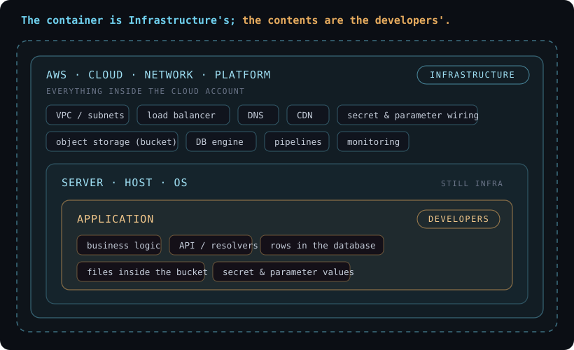

# Infrastructure and application ownership

Use an explicit ownership contract when planning a deployment:
**infrastructure owns the platform; application teams own its contents.**

| Infrastructure | Application |
|---|---|
| Database engine and access wiring | Schema, migrations and rows |
| Bucket and access policy | Objects and their lifecycle |
| Secret store and access wiring | Secret values and rotation procedure |
| Deployment platform and guardrails | Application revision and behavior |

This is a planning convention to agree with the teams involved, not an access
policy or a universal division of responsibility. Security and incident response
still need named owners on both sides. Record the agreement in an
[architecture decision](architecture.md) before automating writes.

Engineering OS provides notes and task tracking. It does not enforce this
boundary or deploy infrastructure. Its retrieval and writing rules remain
[unified reading, segregated writing](concepts.md).
