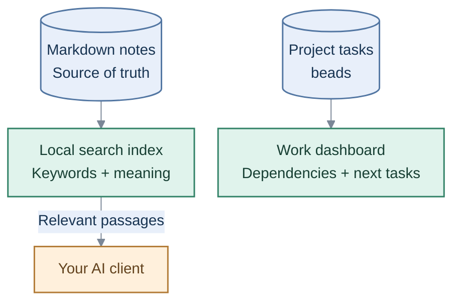

Engineering knowledge / Portable tasks

# Turn your notes into useful context.

Keep knowledge in Markdown, retrieve the relevant passages and track work with beads. Your files stay portable; Linear is optional.

## How it works

[Start locally](quickstart.md){ .overview-link }
[See the work graph](dashboard.md){ .overview-link }
[Portability and boundaries](portable-portfolio.md){ .overview-link }

!!! note "Scope"
    Retrieval runs locally. A connected cloud AI client may transmit retrieved text. Keep private trust domains in separate indexes.
